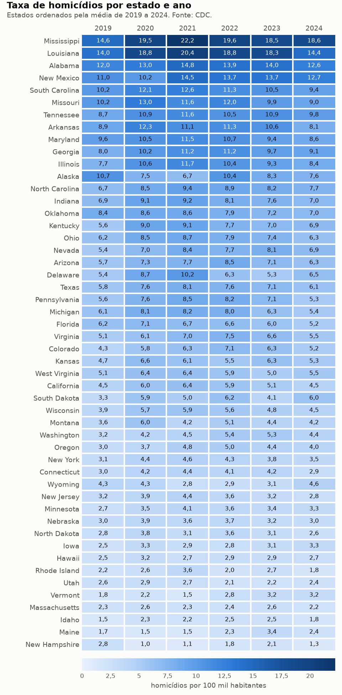
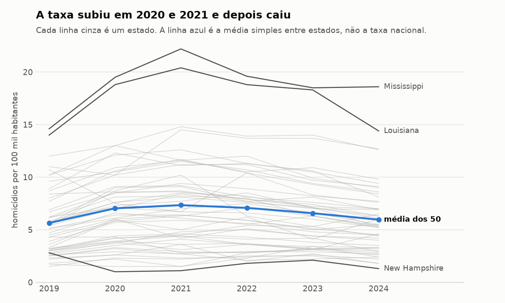
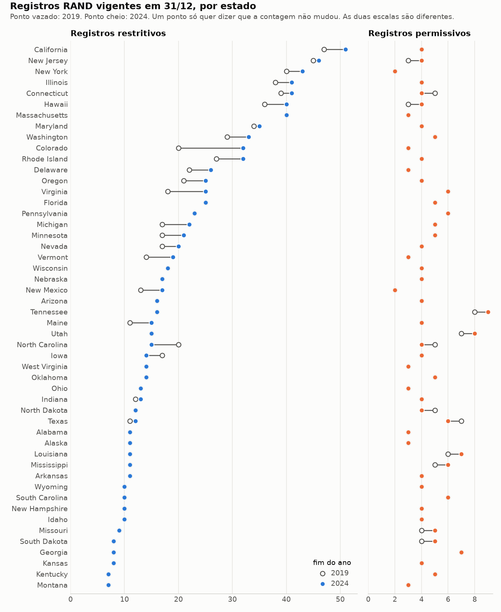
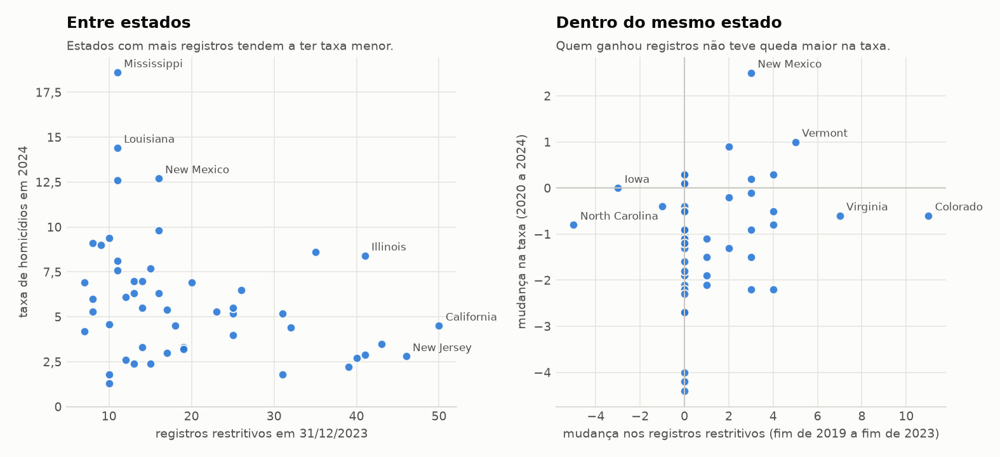
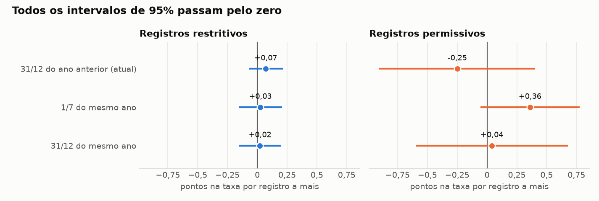

# Semana 2: revisão, gráficos e resultado

**Pergunta:** os registros de regras estaduais sobre armas da RAND têm relação com a taxa de homicídios nos estados americanos?

**Resposta até aqui:** com os dados de 2019 a 2024, não achamos uma relação clara. O resultado é inconclusivo e não prova nem descarta impacto das leis.

## 1. Os resultados se repetem?

Rodamos os notebooks em uma cópia nova do repositório, com um ambiente criado só a partir do `requirements.txt` (Python 3.13). Os coeficientes do 06 saíram iguais aos que já estavam em `reports/results/association_model.csv`:

| Termo | Valor salvo | Valor na nova execução |
| --- | ---: | ---: |
| Registros restritivos | 0,0709 | 0,0709 |
| Registros permissivos | -0,2505 | -0,2505 |
| Desemprego | 0,0677 | 0,0677 |
| Renda (por 10 mil dólares) | 1,1921 | 1,1921 |

A diferença só aparece depois da 12ª casa decimal. O painel também saiu com 300 linhas e 15 colunas, e os 5 testes passam.

Dois problemas apareceram no caminho:

- **Faltava `openpyxl` no `requirements.txt`.** Sem ele o 02 para no `read_excel`. Já foi incluído.
- **Os brutos do BLS e do BEA não estão no Git.** Na cópia nova, pegamos as mesmas séries nas tabelas do FRED (St. Louis Fed), que republica os dados do BLS e do BEA, e montamos os CSVs processados. Os notebooks 03 e 04 rodaram pelo caminho "processado". Como os coeficientes bateram, os valores de 2019 a 2023 (os que o modelo usa) são os mesmos dos arquivos brutos. Para o CDC, conferimos a soma das taxas e das contagens de cada ano com a API.

O 01 precisa de internet para baixar o CDC. Sem internet ele não roda.

## 2. Revisão da contagem RAND

Detalhes no [notebook 07](../notebooks/07_revisao_rand.ipynb).

**Datas.** Dos 1.781 registros `Implement`/`Modify` dos 50 estados, nenhum está sem data de início ou com fim antes do início. As 6 revogações do período fecham corretamente o registro revogado.

**Quando as regras começam.** Entre 2019 e 2024 começaram a valer 157 registros. Só 21 em 1º de janeiro, 34 em 1º de julho e 102 em outras datas. Mais da metade (82) começou no segundo semestre. Como contamos em 31/12 do ano anterior, uma regra que começa em março só entra na conta do ano seguinte.

**O que a contagem mede.** Três cuidados:

- Poucos tipos de regra dominam. Idade mínima, pessoas proibidas de ter arma e checagem de antecedentes são 641 dos 988 registros restritivos vigentes no fim de 2023. Entre os 214 permissivos, 179 são de preempção de leis locais, porte velado, legítima defesa em casa e porte aberto.
- Uma lei pode valer vários registros. Quando a Carolina do Norte acabou com a licença para comprar pistola, em março de 2023, a contagem do estado caiu de 20 para 15 restritivos de uma vez.
- `Effect` indica a direção da mudança, não o tipo da lei. No porte velado da Califórnia, a mudança de 2022 conta como permissiva e a de 2024 como restritiva, e as duas seguem vigentes. A regra antiga de licença a critério da autoridade (`may issue`) também aparece como permissiva.

Somar registros trata todos esses casos como se tivessem o mesmo peso. É a principal fraqueza da nossa medida.

## 3. Gráficos

Feitos no [notebook 08](../notebooks/08_graficos.ipynb) e salvos em `reports/figures/`.



A diferença entre estados é grande e estável: o Mississippi fica perto de 20 por 100 mil e New Hampshire perto de 1 ou 2.



Quase todos os estados subiram em 2020 e 2021 e depois caíram. A média entre estados foi de 5,65 em 2019 para 7,34 em 2021 e voltou a 5,96 em 2024. Mesmo assim, 32 dos 50 estados terminaram 2024 com taxa maior que a de 2019.



A contagem de restritivos vai de 7 (Montana, Kentucky) a 51 (Califórnia). Dentro de cada estado ela muda pouco: 27 estados não tiveram nenhuma mudança líquida nos restritivos e 38 não tiveram nos permissivos. O Colorado é a exceção, com 12 registros a mais.



Entre estados existe correlação negativa (-0,31): mais registros restritivos, taxa menor. Mas os estados com mais registros também são mais ricos (correlação de 0,66 entre renda e registros), e renda tem correlação de -0,56 com a taxa. Dentro do mesmo estado a relação não aparece: os 20 estados que ganharam registros tiveram queda média de 0,63 na taxa entre 2020 e 2024, e os 27 que não mudaram tiveram queda de 1,49. Os que não mudaram são os que tinham taxa mais alta em 2020, subiram mais e caíram mais.

## 4. Resultado do modelo e limitações

O modelo do 06 compara cada estado com ele mesmo ao longo do tempo, desconta o movimento geral de cada ano e considera desemprego e renda do ano anterior. São 250 observações (2020 a 2024).

| Contagem no fim do ano anterior | Coeficiente | Intervalo de 95% |
| --- | ---: | ---: |
| Registros restritivos | 0,071 | -0,072 a 0,213 |
| Registros permissivos | -0,251 | -0,904 a 0,403 |

Os dois intervalos passam pelo zero. No 07 testamos se isso depende das nossas escolhas:



| Data da contagem | Restritivos | Permissivos |
| --- | ---: | ---: |
| 31/12 do ano anterior (atual) | 0,071 | -0,251 |
| 1/7 do mesmo ano | 0,025 | 0,360 |
| 31/12 do mesmo ano | 0,022 | 0,040 |

O coeficiente dos restritivos fica sempre perto de zero. O dos permissivos troca de sinal conforme a data. Nenhum intervalo sai do zero em nenhum dos três casos, nem quando tiramos um estado por vez (50 rodadas).

**Limitações:**

- **Pouca variação.** Nos anos que o modelo usa, a contagem de restritivos mudou 40 vezes em 23 estados, e a de permissivos só 8 vezes em 8 estados. Com tão pouco, qualquer detalhe muda o coeficiente.
- **A medida é grosseira.** Um registro de idade mínima vale o mesmo que um de checagem de antecedentes, e uma lei só pode virar cinco registros.
- **Período curto e atípico.** Seis anos, com a alta de 2020 e 2021 no meio.
- **O desfecho é amplo.** A taxa do CDC inclui homicídios por qualquer meio, não só por arma de fogo.
- **Faltam outros fatores.** Desemprego e renda não cobrem policiamento, demografia, drogas ou cultura local. A renda é nominal.
- **A ordem pode ser inversa.** Estados podem mudar leis porque a violência subiu.

O coeficiente da renda tem intervalo de 0,007 a 2,377, encostado no zero. Ele não é a nossa pergunta e não deve ser lido como efeito da renda.

## 5. Conclusão

Estados com mais regras restritivas registradas têm taxas de homicídios menores, mas essa diferença já existia antes do período e acompanha a renda. Quando olhamos o que acontece dentro de cada estado depois que a contagem muda, não aparece uma direção clara: os intervalos incluem zero e o sinal dos permissivos depende da data de corte.

Então a comparação atual é inconclusiva. Ela não mostra que as leis reduzem homicídios e também não mostra que não reduzem. Para responder melhor seria preciso um período mais longo, olhar um tipo de regra por vez e usar homicídios por arma de fogo.

## Como refazer

```bash
python -m venv .venv
.venv/bin/pip install -r requirements.txt
.venv/bin/python -m unittest discover -s tests -v
```

Depois execute os notebooks de 01 a 08 na ordem. O 07 grava `reports/results/cutoff_sensitivity.csv` e o 08 grava as figuras.
